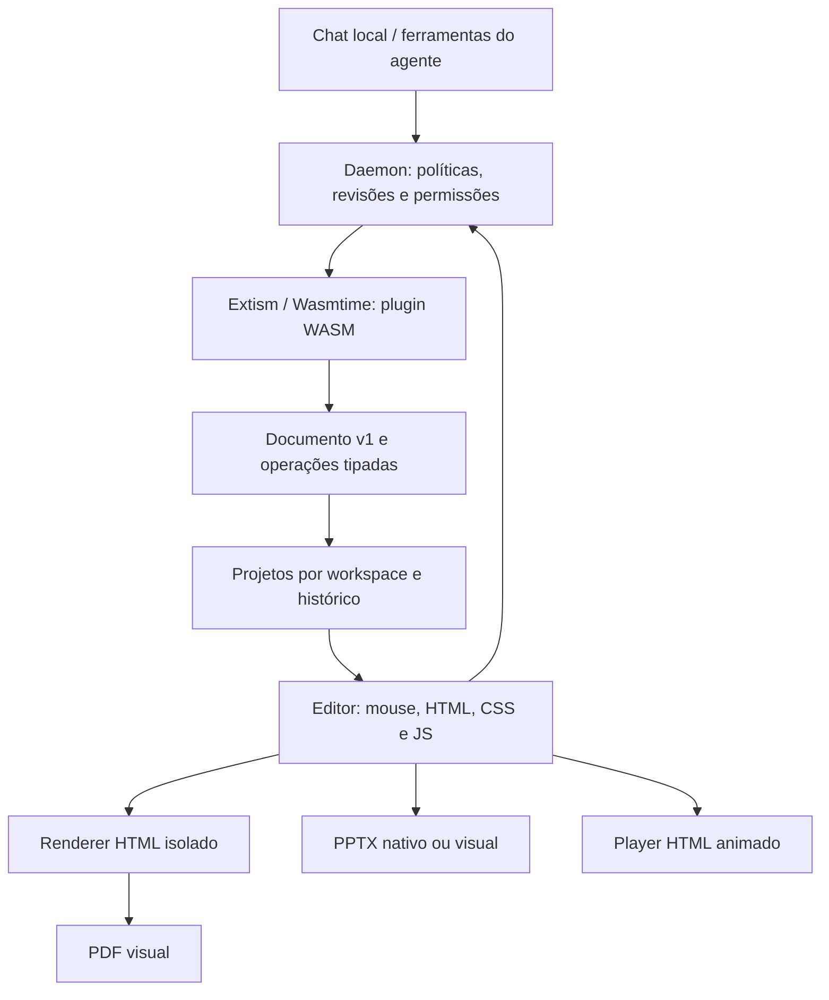

# Plugins WASM e Presentation Studio — issue #37

## Como usar

Inicie o daemon e abra a aba **Apresentações** do desktop. A interface e os exportadores já estão empacotados: o usuário não precisa de Node, npm, Chromium externo ou conexão com a nuvem para editar/exportar.

1. Crie um projeto e escolha layouts: capa, conteúdo, comparação, imagem, gráfico, tabela e encerramento.
2. Envie PNG/JPEG/WebP em **Imagens** ou arraste arquivos para o editor. Adicione uma descrição para a IA; clique **Inserir** para colocar no slide. **Paleta** extrai uma cor de destaque da imagem. A importação de paleta aceita JSON/TXT/CSS com cores `#RRGGBB`, na ordem fundo, texto, destaque, secundária.
3. Escolha um modelo local já instalado, informe o briefing e peça alterações pelo chat. Exemplo: “Use a imagem enviada como abertura, mantenha nossa paleta, crie três slides sobre estes dados e aplique entradas suaves”. O contexto inclui o slide selecionado, a estrutura da apresentação e descrições dos recursos; os bytes das imagens não são enviados ao modelo de texto.
4. Clique/arraste/redimensione os elementos. O inspetor altera conteúdo, coordenadas, fontes, cores, ordem, dados de gráficos/tabelas e animações. Desfazer/refazer e histórico persistente permitem recuperar versões.
5. **Código e validação** oferece HTML estruturado, CSS local, JavaScript e JSON. JavaScript recebe `deck` e altera o documento; não roda dentro do aplicativo. Exemplo: `deck.slides[0].elements[0].animation = "rise";`.
6. **Apresentar** abre o player. Setas/espaço mudam slides; F solicita tela cheia; o botão Fechar retorna ao editor. O HTML exportado também funciona offline.
7. Exporte PDF, PPTX, HTML ou JSON. Reimporte JSON para continuar editando com imagens e histórico futuro. O salvamento automático usa revisões; em conflito, exporte o JSON local ou recarregue a versão salva.

### O que cada formato preserva

| Formato | Conteúdo | Limite deliberado |
| --- | --- | --- |
| Projeto JSON | Fonte editável, imagens, CSS, script, notas, animações | Formato de autoria e reimportação; até 24 MB |
| HTML | Layout/CSS e animações de entrada/transição | Player offline; o script de autoria não é executado novamente |
| PDF | Visual renderizado, 16:9, uma página por slide | Páginas rasterizadas; texto não selecionável; estático |
| PPTX editável | Textos, formas, imagens, tabelas, gráficos nativos e notas | CSS arbitrário e animações não são traduzidos |
| PPTX visual | Uma imagem fiel por slide, incluindo CSS | Ative a opção no editor; elementos não são editáveis individualmente |

A exportação PPTX parte do mesmo documento estruturado que produz o PDF. Não tenta recuperar semântica a partir de um PDF rasterizado. Slides usam 1280 × 720; o PPTX usa proporção 16:9 e converte medidas para polegadas/pontos.

## Arquitetura



- `crates/plugin-runtime`: manifesto API v1, validação JSON Schema, integridade SHA-256, carregamento Extism e execução limitada.
- `packages/plugin-sdk`: SDK TypeScript/JavaScript e CLI `init`, `build`, `test`, `pack`.
- `crates/presentation`: contrato serializável e operações atômicas; compilado no host e no guest.
- `plugins/presentation-studio/guest`: plugin Rust real, compilado para WASM, que aplica operações de edição.
- `crates/daemon/src/presentations.rs`: armazenamento, revisões, instalação/ativação e adaptação para ferramentas do agente.
- `plugins/presentation-studio/src`: interface, renderizador, sandbox de autoria e exportadores. Os bundles gerados em `apps/desktop-ui/ui` entram no desktop existente.

A inspiração do SillyTavern está em extensões com manifesto, ferramentas declaradas e gerenciamento pelo usuário. A fronteira de execução é diferente: plugins de terceiros não recebem acesso ao DOM principal nem importações privilegiadas do host. O painel completo do Studio é uma integração embarcada confiável; a API v1 de terceiros oferece ferramentas de computação WASM e frontends HTML/CSS/JS empacotados, executados em iframes de origem opaca. O host verifica a janela emissora e limita cada chamada às ferramentas do próprio plugin. Não há APIs de rede/credenciais.

### Contrato de plugin

Um `.mlxplugin.json` contém `manifest` e `wasm_base64`. O manifesto declara `api_version: 1`, `id`, `name`, `version`, `permissions`, `tools` e, opcionalmente, `frontend: {html, css, javascript}` (até 1 MiB). O inventário retorna apenas `has_frontend`; os assets são carregados ao abrir o plugin. Cada ferramenta contém `name`, `description`, `parameters` (JSON Schema de objeto), `export` e `mutating`.

A ABI usa JSON UTF-8 de entrada/saída via Extism. Um export é uma função WASM chamada pelo nome do manifesto. No agente, o nome público é `<plugin_id>__<tool_name>`. IDs e exports são snake_case, limitados a 30 caracteres. Schemas com referências externas são rejeitados.

Instalação: **Plugins → Adicionar plugin → selecionar pacote → revisar permissões → Instalar plugin**. A instalação valida e compila o módulo antes de persistir. Ativar/desativar vale para chamadas seguintes; os catálogos do agente são reconstruídos a cada execução. Atualizações passam pelo mesmo fluxo de instalação. O plugin embarcado `presentation` não pode ser substituído por terceiros; atualização do binário embarcado conserva sua ativação/permissões.

### Permissões e limites

- `compute`: execução de funções puras de computação.
- `documents:read` e `documents:write`: usadas pelo broker do Studio para documentos do workspace. Declarar essas permissões em um plugin de terceiros não cria APIs de filesystem/documentos dentro do guest.
- Todas as permissões declaradas precisam de grants. Desativar um plugin impede novas invocações. O modo Locked bloqueia ferramentas; ReadOnly/DryRun bloqueiam mutações do agente.
- WASI é habilitado para compatibilidade com o PDK JavaScript, sem diretórios ou variáveis de ambiente concedidos pelo manifesto. Nenhum caminho/URL do manifesto externo é encaminhado ao Extism; HTTP do runtime está desabilitado na compilação. Não há shell, Tauri, acesso a credenciais ou imports personalizados de host.
- Cada chamada tem combustível de 100 milhões de instruções, timeout de 5 s, memória de 256 MiB e entrada/saída de até 24 MiB. Pacotes WASM têm limite de 8 MiB. A compilação é feita pelo host; esses limites de execução não são uma quota global de CPU/disco.
- SHA-256 detecta alteração do WASM persistido; não é assinatura de autor ou certificação de confiança.
- Preview: iframe sem scripts. Autoria JavaScript: iframe de origem opaca + Worker, CSP sem rede e prazo de 2 s. Só o documento resultante validado pelo host é persistido.
- Arquivos de imagem são embutidos; SVG/URLs remotas são rejeitados. CSS não aceita imports, URLs, escapes, fontes externas ou markup. O HTML exportado também usa CSP restritiva.
- Até 60 slides, 100 elementos por slide e 50 imagens por projeto. Upload de até 5 MB/imagem. Revise o uso de memória antes de elevar esses limites.

### Persistência e concorrência

Dados ficam em `presentation-studio` ao lado do arquivo de configurações do daemon. Os projetos são separados por hash do caminho canônico do workspace. IDs são validados antes de compor caminhos. A gravação do documento atual usa arquivo temporário e rename; a revisão precisa corresponder à revisão salva. Um conflito retorna HTTP 409. São mantidas até 20 revisões anteriores. Desfazer/refazer local também mantém até 20 estados.

Projetos importados ou resultados de código inválidos não substituem o documento válido. Lotes WASM são atômicos. A edição transporta referências/metadados de imagens para o guest; os bytes ficam no host e são recolocados intactos antes de salvar, evitando gastar combustível WASM em base64. Não há sincronização entre dispositivos nem edição colaborativa simultânea: o segundo editor deve recarregar após conflito.

## SDK: criar uma ferramenta

Requer Node 20+, npm, [Extism JavaScript PDK](https://github.com/extism/js-pdk) (`extism-js`) e Binaryen (`wasm-opt`/`wasm-merge`) no PATH para **compilar**. A instalação/execução de pacotes prontos não usa Node ou scripts de build.

```sh
npm ci --prefix packages/plugin-sdk
node packages/plugin-sdk/src/cli.mjs init my_plugin
cd my_plugin
npm install
npm run build
npm run pack
```

O scaffold aponta para o SDK deste checkout por dependência `file:`. O nome do pacote npm é reservado aqui para uso local; não pressupõe publicação no npm.

```ts
import { definePlugin, defineTool } from '@mlx-pilot/plugin-sdk';
export default definePlugin({
  id: 'calculator', name: 'Calculator', version: '1.0.0',
  permissions: ['compute'],
  tools: [defineTool({
    name: 'sum', description: 'Sum user-provided values.',
    parameters: {
      type: 'object',
      properties: { values: { type: 'array', items: { type: 'number' }, maxItems: 100 } },
      required: ['values'], additionalProperties: false
    },
    execute({values}: {values: number[]}) {
      return {sum: values.reduce((a, b) => a + b, 0)};
    }
  })]
});
```

`execute` deve ser síncrono e produzir JSON. APIs de Node, DOM, fetch e acesso ao sistema não estão disponíveis no guest. O build executa definições do próprio desenvolvedor para derivar o manifesto; não execute builds de fontes não confiáveis. O instalador recebe apenas JSON/WASM.

Para testar a lógica, crie `fixtures.json` com `[{"tool":"sum","input":{"values":[2,3]},"expected":{"sum":5}}]` e execute `npx mlx-plugin test`. Os testes de fixtures executam JavaScript local; teste também o pacote compilado via daemon para validar a ABI e os limites.

## Ferramentas do agente e modelo local

`presentation_instructions`, `presentation_list`, `presentation_create`, `presentation_get`, `presentation_edit` e `presentation_validate` são registradas nos toolsets general/full, respeitando seleção explícita e políticas. O contrato completo está em `plugins/presentation-studio/AGENT.md`. Exportação e preview visual acontecem no editor aberto, não como ferramentas headless do agente.

O chat do Studio usa `/chat` com o modelo local selecionado e temperatura baixa. O modelo produz até 20 operações em JSON; o daemon valida e aplica pelo WASM. Em resposta inválida, há uma tentativa de reparo com a mensagem de erro. IDs, revisões, temas e imagens existentes são preservados pelo contrato. O contexto compacto e exemplos explícitos ajudam modelos pequenos; a qualidade narrativa/visual ainda depende do modelo e deve ser revisada. Descrições tornam imagens utilizáveis por modelos sem visão, mas não equivalem à análise visual automática.

Animações suportadas: none/fade/rise/slide/zoom por elemento, atraso de até 10 s; transições none/fade/slide. O player respeita `prefers-reduced-motion`. PDF e PPTX são estáticos.

### Endpoints locais

| Método e caminho | Função |
| --- | --- |
| GET/POST `/presentations` | Listar/criar |
| GET/PUT `/presentations/{id}` | Ler/salvar com `base_revision` e `document` |
| POST `/presentations/{id}/edit` | Aplicar `operations` com `base_revision` pelo WASM |
| GET `/presentations/{id}/validate` | Diagnósticos estruturais/geométricos |
| GET `/presentations/{id}/history` | Revisões recuperáveis |
| POST `/presentations/{id}/restore` | Restaurar revisão criando uma nova |
| GET `/presentations/instructions` | Contrato para modelos |
| GET/POST `/agent/wasm-plugins` | Inventário/instalação com grants explícitos |
| PATCH `/agent/wasm-plugins/{id}` | Ativar/desativar (`enabled`) |
| DELETE `/agent/wasm-plugins/{id}` | Remover pacote, preservando documentos |
| GET `/agent/wasm-plugins/{id}/frontend` | Assets do frontend, com grants e estado ativo validados |
| POST `/agent/wasm-plugins/bundled/presentation` | Reinstalar o Studio embarcado |
| POST `/agent/wasm-plugins/{id}/tools/{tool}` | Invocar ferramenta de terceiros |

Essas rotas seguem a configuração de acesso local já usada pelo daemon. Não exponha o daemon como serviço multiusuário sem uma camada de autenticação/isolamento adicional.

## Desenvolvimento e verificação

```sh
npm ci --prefix plugins/presentation-studio
npm test --prefix plugins/presentation-studio
npm test --prefix packages/plugin-sdk
npm run build --prefix plugins/presentation-studio
cargo test -p mlx-presentation -p mlx-plugin-runtime -p mlx-ollama-daemon -p mlx-agent-core
cargo clippy -p mlx-presentation -p mlx-plugin-runtime -p mlx-ollama-daemon --all-targets -- -D warnings
```

Ao mudar o contrato Rust ou o guest, recompile o WASM embarcado **antes** do daemon:

```sh
rustup target add wasm32-unknown-unknown
npm run build:wasm --prefix plugins/presentation-studio
cargo build -p mlx-ollama-daemon
```

Mantenha fonte, lockfiles, `plugin.wasm` e os dois bundles de UI juntos. O CI verifica testes JS e regeneração dos bundles. O WASM usa seu próprio Cargo.lock; uma reprodução byte a byte depende também da mesma versão do compilador Rust.

Verificação manual de release: iniciar daemon isolado; criar slides com imagem/gráfico/tabela; testar chat, HTML, CSS e JS; mover/redimensionar e desfazer; recarregar; induzir conflito de revisões; exportar e abrir PDF/PPTX/HTML; verificar bloqueio de plugin desativado, schema inválido e JS infinito. O diagnóstico de overflow do DOM é calculado para o slide visível; os demais slides devem ser revisados antes de distribuir a apresentação.

### Validação desta implementação (10/10/2026)

- 169 testes Rust nos componentes afetados e 9 testes JavaScript; Clippy com warnings tratados como erro e `cargo check` do desktop Tauri em macOS.
- Navegador: seis slides, upload de imagem, extração de cor, edição HTML/JS, arraste, desfazer/refazer, persistência e download dos quatro formatos. Player, reparo de resposta inválida (respostas de chat simuladas com backend/WASM reais), timeout de JS infinito e bloqueio de plugin desativado também exercitados.
- PDF com seis páginas, renderização visual conferida; PPTX inspecionado como pacote OOXML com texto, gráfico e tabela nativos. Não foi executado Microsoft PowerPoint para verificação visual do PPTX.
- SDK: scaffold TypeScript compilado com Extism JS PDK 1.7.0/Binaryen 133, empacotado, instalado e invocado pelo daemon; entrada `[2,4,8]` retornou contagem 3 e soma 14.
- Qwen 2.5 0.5B executado localmente, por CPU, produziu operação válida a partir das instruções com exemplos completos; o WASM aplicou a alteração e o host persistiu a revisão. Posteriormente, o Ollama foi atualizado para 0.30.7 e a inferência pelo daemon foi validada.

## Frontend no SDK

Declare `frontend: { html: "src/index.html", script: "src/frontend.ts", style: "src/frontend.css" }`
em `definePlugin`. O CLI gera esses arquivos no `init` e empacota o JavaScript
para navegador no `build`, sem scripts de instalação executados pelo host.

```ts
import { createFrontendClient } from '@mlx-pilot/plugin-sdk';
const host = createFrontendClient();
const result = await host.invoke('summarize_numbers', { values: [10, 20, 30] });
// { count: 3, sum: 60 }
```

As chamadas possuem ID de correlação, timeout e erros estruturados. `dispose()`
remove listeners e rejeita chamadas pendentes. O host usa `sandbox="allow-scripts"`,
CSP própria, valida a janela de origem e não aceita plugin_id vindo do iframe.
A API do daemon revalida ativação, grants, schema e limites do WASM em cada chamada.
Remover o plugin embarcado grava uma marca persistente para impedir reinstalação
implícita no próximo início; o botão de reinstalação remove essa marca.
