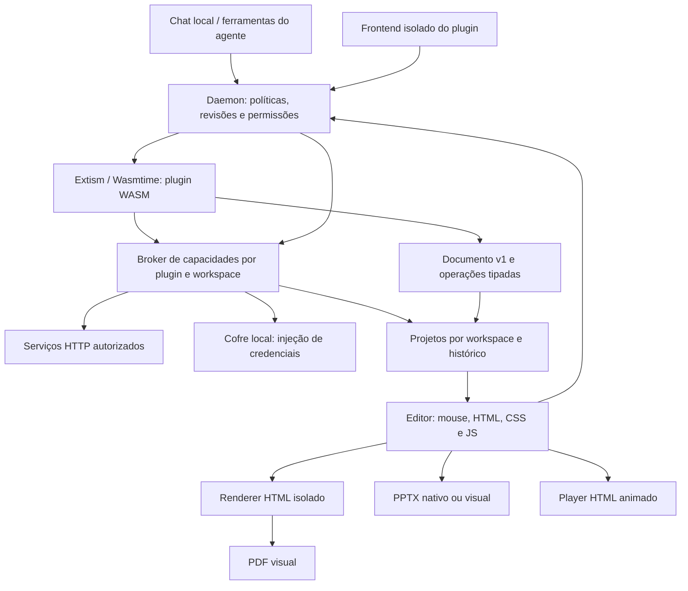

# Plugins WASM e Presentation Studio — issue #37

## Como usar

Inicie o daemon e abra a aba **Apresentações** do desktop. A interface e os exportadores já estão empacotados: o usuário não precisa de Node, npm, Chromium externo ou conexão com a nuvem para editar/exportar.

1. Crie um projeto e escolha layouts: capa, conteúdo, comparação, imagem, gráfico, tabela e encerramento.
2. Envie PNG/JPEG/WebP em **Imagens** ou arraste arquivos para o editor. Adicione uma descrição para a IA; clique **Inserir** para colocar no slide. **Paleta** extrai uma cor de destaque da imagem. A importação de paleta aceita JSON/TXT/CSS com cores `#RRGGBB`, na ordem fundo, texto, destaque, secundária.
3. Escolha um modelo local já instalado, informe o briefing e peça alterações pelo chat. Exemplo: “Use a imagem enviada como abertura, mantenha nossa paleta, crie três slides sobre estes dados e aplique entradas suaves”. O contexto inclui o slide selecionado, a estrutura da apresentação e descrições dos recursos; os bytes das imagens não são enviados ao modelo de texto.
4. Clique/arraste/redimensione os elementos. O inspetor altera conteúdo, coordenadas, fontes, cores, ordem, dados de gráficos/tabelas e animações. Desfazer/refazer e histórico persistente permitem recuperar versões.
5. **Código e validação** oferece HTML estruturado, CSS local, JavaScript e JSON. JavaScript recebe `deck` e altera o documento; não roda dentro do aplicativo. Exemplo: `deck.slides[0].elements[0].animation = "rise";`.
6. **Apresentar** abre o player. Setas/espaço mudam slides; F solicita tela cheia; o botão Fechar retorna ao editor. O HTML exportado também funciona offline.
7. Exporte PDF, PPTX, HTML ou JSON. Reimporte JSON para continuar editando com imagens e histórico futuro. O salvamento automático usa revisões; em conflito, exporte o JSON local ou recarregue a versão salva.

### O que cada formato preserva

| Formato | Conteúdo | Limite deliberado |
| --- | --- | --- |
| Projeto JSON | Fonte editável, imagens, CSS, script, notas, animações | Formato de autoria e reimportação; até 24 MB |
| HTML | Layout/CSS e animações de entrada/transição | Player offline; o script de autoria não é executado novamente |
| PDF | Visual renderizado, 16:9, uma página por slide | Páginas rasterizadas; texto não selecionável; estático |
| PPTX editável | Textos, formas, imagens, tabelas, gráficos nativos e notas | CSS arbitrário e animações não são traduzidos |
| PPTX visual | Uma imagem fiel por slide, incluindo CSS | Ative a opção no editor; elementos não são editáveis individualmente |

A exportação PPTX parte do mesmo documento estruturado que produz o PDF. Não tenta recuperar semântica a partir de um PDF rasterizado. Slides usam 1280 × 720; o PPTX usa proporção 16:9 e converte medidas para polegadas/pontos.

## Arquitetura



- `crates/plugin-runtime`: manifesto API v1, validação JSON Schema, integridade SHA-256, carregamento Extism e execução limitada.
- `packages/plugin-sdk`: SDK TypeScript/JavaScript e CLI `init`, `build`, `test`, `pack`.
- `crates/presentation`: contrato serializável e operações atômicas; compilado no host e no guest.
- `plugins/presentation-studio/guest`: plugin Rust real, compilado para WASM, que aplica operações de edição.
- `crates/daemon/src/presentations.rs`: armazenamento, revisões, instalação/ativação e adaptação para ferramentas do agente.
- `crates/daemon/src/plugin_host.rs`: configuração por workspace e broker de HTTP, credenciais e documentos.
- `plugins/presentation-studio/src`: interface, renderizador, sandbox de autoria e exportadores. Os bundles gerados em `apps/desktop-ui/ui` entram no desktop existente.

A inspiração do SillyTavern está em extensões com manifesto, ferramentas declaradas e gerenciamento pelo usuário. Plugins de terceiros não recebem DOM principal, shell ou filesystem arbitrário. Suas ferramentas WASM e interfaces HTML/CSS/JS usam uma ponte explícita para os recursos autorizados. O painel completo do Studio continua sendo uma integração embarcada; terceiros acessam documentos pelo broker versionado e podem encaminhá-los ao editor para exportação.

O frontend roda em iframe de origem opaca. O host verifica a janela emissora e um token aleatório associado àquela abertura do documento, sem aceitar `plugin_id` escolhido pelo guest. A CSP bloqueia `fetch` direto e carregamento de assets externos. Navegação do próprio iframe não é tratada como impossível: um novo carregamento fecha a interface e invalida sua ponte; um documento externo não recebe o token anterior. Reabrir o plugin gera outro token.

### Contrato de plugin

Um `.mlxplugin.json` contém `manifest` e `wasm_base64`. O manifesto declara `api_version: 1`, `id`, `name`, `version`, `permissions`, `tools` e, opcionalmente, `services` e `frontend: {html, css, javascript}` (até 1 MiB). O inventário retorna `has_frontend` sem incluir os assets; eles são carregados ao abrir o plugin. Cada ferramenta contém `name`, `description`, `parameters` (JSON Schema de objeto), `export` e `mutating`.

`services` contém até 20 declarações `{id, name, base_url, methods, credential?}`. O campo opcional `credential` descreve `{id, header, prefix}` e nunca contém uma chave. IDs usam `snake_case`; `methods` lista métodos HTTP autorizáveis. A URL declarada usa HTTPS; HTTP no manifesto só é aceito em loopback. URLs não podem conter usuário/senha, query ou fragmento. O usuário pode configurar o destino autorizado no workspace, respeitando HTTPS ou a autorização explícita de rede local.

A ABI usa JSON UTF-8 de entrada/saída via Extism. Um export é uma função WASM chamada pelo nome do manifesto. No agente, o nome público é `<plugin_id>__<tool_name>`. IDs e exports são snake_case, limitados a 30 caracteres. Schemas com referências externas são rejeitados.

Instalação: **Plugins → Adicionar plugin → selecionar pacote → revisar permissões e serviços → Instalar plugin**. A revisão mostra destinos, métodos e o cabeçalho/prefixo onde uma credencial será injetada. A instalação valida e compila o módulo antes de persistir. Ativar/desativar vale para chamadas seguintes; os catálogos do agente são reconstruídos a cada execução. Atualizações passam pelo mesmo fluxo de instalação. O plugin embarcado `presentation` não pode ser substituído por terceiros; atualização do binário embarcado conserva sua ativação/permissões.

### Permissões e limites

- `compute`: execução de funções puras de computação.
- `network:request`: requisições pelo broker, somente para um serviço declarado, autorizado no workspace e usando um método permitido.
- `credentials:use`: consulta de disponibilidade da chave e autorização para o host injetá-la nas chamadas daquele serviço. O valor não é uma resposta da API do SDK.
- `documents:read`: listar e ler projetos explicitamente autorizados. `get` retorna metadados das imagens, sem `data_url`.
- `documents:write`: criar projetos quando `allow_create` estiver concedido e editar projetos autorizados com operações e revisão otimista.
- Todas as permissões declaradas precisam de grants. Revogar qualquer uma bloqueia a execução do plugin; desativá-lo impede novas invocações. No agente, Locked bloqueia ferramentas; ReadOnly/DryRun bloqueiam mutações. Ferramentas que gravam documentos ou enviam métodos HTTP diferentes de GET/HEAD/OPTIONS precisam de `mutating: true` e execução Full. Chamadas da interface passam pelas mesmas autorizações de recursos no host.
- WASI é habilitado para compatibilidade com o PDK JavaScript, sem diretórios ou variáveis de ambiente concedidos pelo manifesto. Nenhum caminho/URL externo é encaminhado ao Extism; seu HTTP nativo está desabilitado. A importação `mlx_host_call` fornece apenas as operações do broker, sem shell, Tauri ou filesystem arbitrário.
- O WASM tem combustível de 100 milhões de instruções, memória de 256 MiB e entrada/saída de até 24 MiB. Execução sem broker tem timeout de 5 s; com broker, 60 s. Pacotes WASM têm limite de 8 MiB. Esses limites não são uma quota global de CPU/disco.
- O broker permite até 3 requisições HTTP por invocação, até 15 s por requisição e prazo total de 45 s para suas chamadas. DNS/conexão são limitados a 3 s. Corpos HTTP de entrada/saída têm limite de 1 MiB. Redirecionamentos e proxy de ambiente não são usados; a resolução DNS é conferida e fixada antes da conexão. Endereços privados/loopback exigem opt-in, e HTTP só alcança endereços locais autorizados. Credenciais e cabeçalhos de autenticação são controlados pelo host.
- SHA-256 detecta alteração do WASM persistido; não é assinatura de autor ou certificação de confiança.
- Preview: iframe sem scripts. Autoria JavaScript: iframe de origem opaca + Worker, CSP sem rede e prazo de 2 s. Só o documento resultante validado pelo host é persistido.
- Arquivos de imagem são embutidos; SVG/URLs remotas são rejeitados. CSS não aceita imports, URLs, escapes, fontes externas ou markup. O HTML exportado também usa CSP restritiva.
- Até 60 slides, 100 elementos por slide e 50 imagens por projeto. Upload de até 5 MB/imagem. Revise o uso de memória antes de elevar esses limites.

### Configuração e ciclo de autorização

Cada plugin de terceiros tem **Configurar**, inclusive quando desativado. A tela permite revogar/conceder grants, habilitar serviços, definir a URL autorizada, consentir rede local, cadastrar/substituir/remover credenciais e escolher IDs de documentos. **Permitir criar novas apresentações** é uma autorização separada da lista de projetos existentes.

Serviços começam desabilitados e nenhum documento é autorizado por padrão. A chave é digitada em campo de senha: vazio mantém o valor anterior; preenchido o substitui; **Remover credencial cadastrada** o apaga. GET de configuração retorna apenas `credential_set`. O SDK não oferece leitura ou gravação do segredo: `credentials.status(service)` informa somente `{configured: boolean}`. O cofre local armazena chaves criptografadas.

Grants de permissões pertencem à instalação do plugin e valem globalmente para ela. Serviços, IDs de documentos, `allow_create` e chaves são separados por workspace. Uma alteração no conjunto declarado de serviços/permissões muda sua impressão digital e zera as autorizações de serviços/documentos daquele workspace. A chave pode continuar cadastrada quando o serviço e o ID da credencial forem mantidos, mas novas chamadas dependem da reautorização do destino. Remover o plugin apaga sua configuração e seu cofre; os documentos criados permanecem.

Salvar configuração atualiza a interface já aberta quando ainda autorizada. Se uma permissão necessária for revogada, o iframe é fechado. Conceder novamente as permissões permite **Abrir**. Ao atualizar o SDK, recompile e reinstale frontends antigos: mensagens sem o token por documento são recusadas com orientação para atualização.

### Persistência e concorrência

Dados ficam em `presentation-studio` ao lado do arquivo de configurações do daemon. Os projetos são separados por hash do caminho canônico do workspace. IDs são validados antes de compor caminhos. A gravação do documento atual usa arquivo temporário e rename; a revisão precisa corresponder à revisão salva. Um conflito retorna HTTP 409. São mantidas até 20 revisões anteriores. Desfazer/refazer local também mantém até 20 estados.

Projetos importados ou resultados de código inválidos não substituem o documento válido. Lotes WASM são atômicos. A edição transporta referências/metadados de imagens para o guest; os bytes ficam no host e são recolocados intactos antes de salvar, evitando gastar combustível WASM em base64. Não há sincronização entre dispositivos nem edição colaborativa simultânea: o segundo editor deve recarregar após conflito.

## SDK: criar uma ferramenta

Requer Node 20+, npm, [Extism JavaScript PDK](https://github.com/extism/js-pdk) (`extism-js`) e Binaryen (`wasm-opt`/`wasm-merge`) no PATH para **compilar**. A instalação/execução de pacotes prontos não usa Node ou scripts de build.

```sh
npm ci --prefix packages/plugin-sdk
node packages/plugin-sdk/src/cli.mjs init my_plugin
cd my_plugin
npm install
npm run build
npm run pack
```

O scaffold aponta para o SDK deste checkout por dependência `file:`. O nome do pacote npm é reservado aqui para uso local; não pressupõe publicação no npm.

```ts
import { definePlugin, defineTool } from '@mlx-pilot/plugin-sdk';
export default definePlugin({
  id: 'calculator', name: 'Calculator', version: '1.0.0',
  permissions: ['compute'],
  tools: [defineTool({
    name: 'sum', description: 'Sum user-provided values.',
    parameters: {
      type: 'object',
      properties: { values: { type: 'array', items: { type: 'number' }, maxItems: 100 } },
      required: ['values'], additionalProperties: false
    },
    execute({values}: {values: number[]}) {
      return {sum: values.reduce((a, b) => a + b, 0)};
    }
  })]
});
```

`execute` deve ser síncrono e produzir JSON. APIs de Node, DOM, fetch e acesso ao sistema não estão disponíveis no guest; use `createHostClient()` para as capacidades declaradas. O build executa definições do próprio desenvolvedor para derivar o manifesto; não execute builds de fontes não confiáveis. O instalador recebe apenas JSON/WASM.

Para testar a lógica, crie `fixtures.json` com `[{"tool":"sum","input":{"values":[2,3]},"expected":{"sum":5}}]` e execute `npx mlx-plugin test`. Os testes de fixtures executam JavaScript local; teste também o pacote compilado via daemon para validar a ABI e os limites.

### SDK: serviços, credenciais e documentos

`createHostClient()` cria o cliente **síncrono** para o guest WASM. `createFrontendClient()` oferece as mesmas capacidades como **Promises** no navegador, além de `invoke(tool, input)` para chamar uma ferramenta do próprio plugin. Não é necessário implementar `fetch`, gerenciar URLs do daemon ou transportar chaves na interface.

| Chamada | Entrada e resultado |
| --- | --- |
| `host.http.request(input)` | `{service, path, method?, headers?, body?, response_type?}` → `{status, headers, body, encoding}` |
| `host.credentials.status(service)` | ID do serviço → `{configured: boolean}` |
| `host.documents.list()` | Lista de `{id, title, revision, slides}` autorizados |
| `host.documents.get(id)` | Documento estruturado, com metadados de imagens sem bytes |
| `host.documents.create({title})` | Novo documento; seu ID passa a ser autorizado para o plugin |
| `host.documents.edit({id, base_revision, operations})` | `{id, revision, slides, diagnostics}` após edição pelo WASM |

Em HTTP, `path` começa com uma única `/` e permanece na origem do serviço configurado; pode conter a query da requisição. Não é uma URL absoluta. `response_type` aceita `json` (padrão), `text` ou `base64`. Confira `response.status`: uma resposta HTTP de erro continua sendo uma resposta do serviço. Falhas de permissão, configuração, transporte ou limite lançam erro no cliente. Cabeçalhos reservados, incluindo autenticação, não podem ser escolhidos pela chamada do plugin.

Exemplo de ferramenta que consulta uma API com Bearer token. Troque o domínio ilustrativo pelo serviço real e autorize-o em **Configurar**:

```ts
import { createHostClient, definePlugin, defineTool } from '@mlx-pilot/plugin-sdk';

const host = createHostClient();
export default definePlugin({
  id: 'research_api', name: 'Minha API de pesquisa', version: '1.0.0',
  permissions: ['network:request', 'credentials:use'],
  services: [{
    id: 'research', name: 'Pesquisa', base_url: 'https://api.exemplo.com/',
    methods: ['GET'],
    credential: { id: 'api_token', header: 'Authorization', prefix: 'Bearer ' },
  }],
  tools: [defineTool({
    name: 'search', description: 'Consultar a API de pesquisa configurada.',
    parameters: {
      type: 'object', properties: { query: { type: 'string', maxLength: 160 } },
      required: ['query'], additionalProperties: false,
    },
    execute({ query }: { query: string }) {
      if (!host.credentials.status('research').configured)
        throw new Error('Cadastre a chave em Plugins → Configurar.');
      const response = host.http.request({
        service: 'research', path: '/v1/search?q=' + encodeURIComponent(query),
        method: 'GET', response_type: 'json',
      });
      if (response.status !== 200) throw new Error('A consulta não foi concluída.');
      return response.body;
    },
  })],
});
```

O host monta `Authorization: Bearer <chave>` usando o cofre. Não coloque o token
no manifesto, no código, em fixtures ou no input da ferramenta. Não existem
`credentials.get/set`: o cadastro e a remoção acontecem pela UI de configuração.
Para uma API pública, omita `credential` e `credentials:use`, como no Reading Notes.
Para POST/PUT/PATCH/DELETE, declare o método no serviço e `mutating: true` na ferramenta.

Exemplo no frontend, com `documents:read` e `documents:write` declaradas e um
projeto autorizado. Uma revisão concorrente exige ler novamente antes de editar:

```ts
import { createFrontendClient } from '@mlx-pilot/plugin-sdk';
const host = createFrontendClient();
// Ligue esta função ao botão de edição da sua interface.
async function atualizarBriefing() {
  const projects = await host.documents.list();
  if (!projects.length) throw new Error('Selecione um projeto em Configurar.');
  const project = await host.documents.get(projects[0].id);
  return host.documents.edit({
    id: project.id,
    base_revision: project.revision,
    operations: [{ type: 'set_brief', text: 'Briefing informado pelo usuário.' }],
  });
}
window.addEventListener('pagehide', () => host.dispose(), { once: true });
```

Para fazer a mesma edição dentro de uma ferramenta WASM, use `createHostClient()`,
remova os `await` e marque a ferramenta `mutating: true`. No agente, a execução
precisa estar em modo Full. `documents.edit` usa o contrato de operações do
Presentation Studio; não recebe HTML livre nem substitui arquivos arbitrários.

### Exemplo completo: Reading Notes

[`plugins/reading-notes`](../plugins/reading-notes), versão **1.1.0**, inclui
ferramenta WASM, frontend e fixtures. Declara Open Library em HTTPS/GET, sem
credenciais, consulta até cinco livros e cria um **caderno de leitura editável**
no Studio: capa, páginas de referências e fechamento. O briefing e as notas
preservam metadados e URLs. A composição é determinística e não depende de IA;
não infere o conteúdo dos livros a partir do catálogo.

```sh
npm ci --prefix packages/plugin-sdk
npm ci --prefix plugins/reading-notes
npm test --prefix plugins/reading-notes
npm run build --prefix plugins/reading-notes
npm run pack --prefix plugins/reading-notes
```

Instale `plugins/reading-notes/reading_notes-1.1.0.mlxplugin.json`. Abra
**Configurar**, autorize Open Library e permita criar apresentações. A tela oferece
**Pesquisar livros**, **Criar caderno de leitura** e a lista de projetos
autorizados. Criar faz uma nova consulta, então os registros podem mudar entre a
pesquisa e a criação. A composição produz entre três e sete slides para uma a cinco
obras; a captura de `urban gardens` contém cinco slides. O agente pode
usar `reading_notes__search_books`; `reading_notes__create_reading_brief` é mutante
e requer Full. A ferramenta monta os slides antes de criar o projeto e os aplica
em um lote com revisão otimista. Criação e edição são chamadas separadas: uma
falha posterior à criação pode deixar o projeto padrão. Abra o resultado no
Studio para editar e exportar JSON, PDF, PPTX ou HTML.

Títulos e autorias são limitados a 160 pontos de código, com até três autores, e
o ano é a primeira publicação registrada no catálogo. Campos ausentes ficam
identificados. Isso não constitui ranking, recomendação de leitura ou resumo das
obras. Acrescente evidências de uma leitura real antes de pedir uma síntese ao chat.

As fixtures podem declarar `host_calls` com `{operation, input, result}` ou
`{operation, input, error}`. O transportador de teste confere a sequência e as
entradas, sem fazer rede ou acessar chaves. Esses testes validam a lógica e o
contrato do cliente; a integração real exige instalar o WASM e exercer o broker.

## Ferramentas do agente e modelo local

`presentation_instructions`, `presentation_list`, `presentation_create`, `presentation_get`, `presentation_edit` e `presentation_validate` são registradas nos toolsets general/full, respeitando seleção explícita e políticas. O contrato completo está em `plugins/presentation-studio/AGENT.md`. Exportação e preview visual acontecem no editor aberto, não como ferramentas headless do agente.

O chat tem três modos: criar uma apresentação, acrescentar slides e refinar o documento atual. `src/director.js` orquestra o fluxo de criação pelo `/chat`, com o modelo local selecionado, janela de 8192 tokens, `json_mode:true` e saídas limitadas por etapa. O provider Ollama traduz essa opção para [`format: "json"`](https://docs.ollama.com/capabilities/structured-outputs); outros providers continuam recebendo o contrato textual:

1. **Planejamento:** público, objetivo, premissas, estilo, movimento e roteiro (5 slides por padrão, 1–12 por execução).
2. **Composição:** uma chamada por slide produz conteúdo sem coordenadas. `src/design.js` aplica sete layouts e três tratamentos visuais, mede linhas de forma conservadora e rejeita texto que não cabe sem truncar conteúdo. IDs, cores, imagens e primitivas continuam editáveis no mouse, código e PPTX.
3. **Revisão editorial:** lotes de até três slides, com o roteiro completo como referência; corrige clareza, repetição e consistência. Notas existentes são preservadas quando a revisão não as substitui.
4. **Preflight:** `inspectPresentation` renderiza cada slide e mede cortes/sobreposições, além de verificar contraste de fundos sólidos e visibilidade. Há uma rodada de reparo visual, com uma tentativa adicional para JSON/contrato inválido por chamada. Falhas persistentes impedem a gravação do candidato.

Os prompts usam contratos compactos, exemplos concretos e orçamentos de conteúdo por layout. Pedido, briefing, texto, dados e notas existentes entram como fonte em todas as fases; bytes de imagens nunca são enviados. Metadados de imagens são compactados. O material fonte tem limite de 10.000 bytes UTF-8 e cada chamada de 18.000 bytes de entrada textual; excesso pede divisão por seção, sem descartar fatos silenciosamente. Gráficos exigem pares de rótulo/valor explícitos ou séries já presentes, evitando confundir quantidade de slides ou coordenadas com métricas. Uma checagem adicional rejeita quantidades não fornecidas nas unidades reconhecidas (percentuais, temperaturas, prazos e algumas medidas), inclusive em notas. Isso reduz uma classe de alucinações; não certifica a veracidade de toda afirmação ou unidade possível.

A criação monta um candidato em memória e só grava após as verificações. Criar sobre um projeto preenchido usa POST com `document`, recebendo identidade nova; acrescentar usa PUT com revisão otimista e preserva slides anteriores. Append verifica problemas já existentes antes de gastar inferência. Cancelamento ou erro antes da gravação preserva o projeto salvo.

Refinamentos continuam usando até 20 operações JSON pelo WASM, mas primeiro com `dry_run:true` em `/presentations/{id}/edit`. O candidato passa pelo preflight antes de um PUT com `base_revision`. A revisão continua protegida contra concorrência. O contrato para agentes externos está em `AGENT.md`; seus recursos de validação estruturada não equivalem à renderização do navegador.

`src/quality.js` diferencia erros (cortes, bounds, sobreposição de caixas de texto, texto invisível e contraste insuficiente) de avisos (densidade, texto pequeno, contraste não mensurável sobre CSS/imagem). A exportação PDF/PPTX bloqueia erros. PDF usa captura 2× e congela animações; PPTX nativo verifica os estilos estruturados que exporta. CSS personalizado ou imagens sob texto exigem inspeção visual humana. A revisão editorial é textual; não se alega visão de pixels pelo modelo 9B. Descrições não substituem compreensão visual das imagens.

Animações suportadas: none/fade/rise/slide/zoom por elemento, atraso de até 10 s; transições none/fade/slide. O player respeita `prefers-reduced-motion`. PDF e PPTX são estáticos.

### Endpoints locais

| Método e caminho | Função |
| --- | --- |
| GET/POST `/presentations` | Listar/criar |
| GET/PUT `/presentations/{id}` | Ler/salvar com `base_revision` e `document` |
| POST `/presentations/{id}/edit` | Aplicar `operations` com `base_revision` pelo WASM |
| GET `/presentations/{id}/validate` | Diagnósticos estruturais/geométricos |
| GET `/presentations/{id}/history` | Revisões recuperáveis |
| POST `/presentations/{id}/restore` | Restaurar revisão criando uma nova |
| GET `/presentations/instructions` | Contrato para modelos |
| GET/POST `/agent/wasm-plugins` | Inventário/instalação com grants explícitos |
| PATCH `/agent/wasm-plugins/{id}` | Ativar/desativar (`enabled`) |
| DELETE `/agent/wasm-plugins/{id}` | Remover pacote, preservando documentos |
| GET `/agent/wasm-plugins/{id}/frontend` | Assets do frontend, com grants e estado ativo validados |
| GET `/agent/wasm-plugins/{id}/configuration` | Grants, serviços, `credential_set`, autorizações e lista de documentos; nunca retorna segredos |
| PUT `/agent/wasm-plugins/{id}/configuration` | Atualizar grants, todos os serviços declarados e `{ids, allow_create}` de documentos |
| POST `/agent/wasm-plugins/{id}/host` | Ponte do frontend: `{operation, input}`, limitada às capacidades declaradas/autorizadas |
| POST `/agent/wasm-plugins/bundled/presentation` | Reinstalar o Studio embarcado |
| POST `/agent/wasm-plugins/{id}/tools/{tool}` | Invocar ferramenta de terceiros |

O PUT de configuração recebe `{grants, services, documents}`. Cada entrada de
`services` inclui `{enabled, base_url, allow_private_network}` e, opcionalmente,
`credential` para substituir a chave ou `clear_credential: true` para removê-la.
São operações exclusivas; não envie ambas. A resposta tem o mesmo formato
sanitizado do GET. O frontend do plugin não recebe acesso a essas rotas de
administração: usa apenas as capacidades da ponte.

O daemon é local. CORS aceita a UI Tauri e origens locais de desenvolvimento
(`localhost`, `127.0.0.1`, `[::1]`, `tauri.localhost`), não páginas web remotas ou
a origem opaca do guest. A interface isolada usa `postMessage` ao host, que faz a
requisição local. CORS não é autenticação; não exponha o daemon como serviço
multiusuário sem autenticação e isolamento adicionais.

## Desenvolvimento e verificação

```sh
npm ci --prefix plugins/presentation-studio
npm ci --prefix packages/plugin-sdk
npm ci --prefix apps/desktop-ui
npm ci --prefix plugins/reading-notes
npm test --prefix plugins/presentation-studio
npm test --prefix packages/plugin-sdk
node --test apps/desktop-ui/e2e/plugin-manager.test.js
npm test --prefix plugins/reading-notes
npm run build --prefix plugins/presentation-studio
cargo test -p mlx-presentation -p mlx-plugin-runtime -p mlx-ollama-daemon -p mlx-agent-core
cargo clippy -p mlx-presentation -p mlx-plugin-runtime -p mlx-ollama-daemon --all-targets -- -D warnings
```

Ao mudar o contrato Rust ou o guest, recompile o WASM embarcado **antes** do daemon:

```sh
rustup target add wasm32-unknown-unknown
npm run build:wasm --prefix plugins/presentation-studio
cargo build -p mlx-ollama-daemon
```

Mantenha fonte, lockfiles, `plugin.wasm` e os dois bundles de UI juntos. O CI verifica testes JS e regeneração dos bundles. O WASM usa seu próprio Cargo.lock; uma reprodução byte a byte depende também da mesma versão do compilador Rust.

Verificação manual de release: iniciar daemon isolado; criar slides com imagem/gráfico/tabela; testar chat, HTML, CSS e JS; mover/redimensionar e desfazer; recarregar; induzir conflito de revisões; exportar e abrir PDF/PPTX/HTML; verificar bloqueio de plugin desativado, schema inválido e JS infinito. O preflight percorre todos os slides; confira também o resultado visual antes de distribuir a apresentação.

Para o broker, confira serviço desautorizado, URL/método fora do escopo, rede local
sem opt-in, ausência/substituição/remoção de credencial, documento não autorizado,
conflito de revisão e escrita em modo ReadOnly. Teste configuração de plugin
desativado, atualização de manifesto, isolamento entre workspaces, navegação do
iframe, respostas com token incorreto e reinstalação do frontend com SDK atual.

### Registro histórico: Studio inicial (10/10/2026)

Os resultados abaixo correspondem à implementação inicial do Studio. Não validam
as capacidades HTTP, credenciais e documentos posteriormente adicionadas ao SDK;
use os testes e o roteiro de integração acima para essa versão.

- 169 testes Rust nos componentes afetados e 9 testes JavaScript; Clippy com warnings tratados como erro e `cargo check` do desktop Tauri em macOS.
- Navegador: seis slides, upload de imagem, extração de cor, edição HTML/JS, arraste, desfazer/refazer, persistência e download dos quatro formatos. Player, reparo de resposta inválida (respostas de chat simuladas com backend/WASM reais), timeout de JS infinito e bloqueio de plugin desativado também exercitados.
- PDF com seis páginas, renderização visual conferida; PPTX inspecionado como pacote OOXML com texto, gráfico e tabela nativos. Não foi executado Microsoft PowerPoint para verificação visual do PPTX.
- SDK: scaffold TypeScript compilado com Extism JS PDK 1.7.0/Binaryen 133, empacotado, instalado e invocado pelo daemon; entrada `[2,4,8]` retornou contagem 3 e soma 14.
- Qwen 2.5 0.5B executado localmente, por CPU, produziu operação válida a partir das instruções com exemplos completos; o WASM aplicou a alteração e o host persistiu a revisão. Posteriormente, o Ollama foi atualizado para 0.30.7 e a inferência pelo daemon foi validada.

### Atualização da demonstração e Reading Notes 1.1.0 (18/10/2026)

A [apresentação local](apresentacao-plugins/README.md) mostra a interface Orbital
atualizada e dois documentos distintos: o caderno de cinco slides criado pelo
Reading Notes a partir de uma pesquisa real, e um exemplo editorial de cinco
slides preparado para demonstrar o Studio, com duas ilustrações geradas. O segundo
projeto acompanha exports JSON/PDF/PPTX/HTML e não representa uma nova inferência
do modelo local.

O registro histórico anterior de **311 testes Rust, 85 testes JavaScript e
4 fixtures**, com o CI 39166027511 aprovado, permanece como evidência daquela
base. Para esta atualização foram executados **67 testes do Studio**, **3 fixtures
e 8 testes do Reading Notes**, além de chamadas ao **WASM compilado pelo daemon
real** para `urban gardens` e `café`; ambas criaram documentos de cinco slides.
As contagens têm escopos diferentes e não devem ser somadas como uma medida de
cobertura. A [procedência da demonstração](apresentacao-plugins/FONTES-E-CREDITOS.md)
identifica as revisões, a captura e os limites dessas verificações.

## Frontend no SDK

Declare `frontend: { html: "src/index.html", script: "src/frontend.ts", style: "src/frontend.css" }`
em `definePlugin`. O CLI gera esses arquivos no `init` e empacota o JavaScript
para navegador no `build`, sem scripts de instalação executados pelo host.

```ts
import { createFrontendClient } from '@mlx-pilot/plugin-sdk';
const host = createFrontendClient();
document.getElementById('calculate')!.onclick = async () => {
  const result = await host.invoke('summarize_numbers', { values: [10, 20, 30] });
  document.getElementById('result')!.textContent = JSON.stringify(result);
  // { count: 3, sum: 60 }
};
```

As chamadas possuem ID de correlação, token por documento, timeout e erros estruturados. `dispose()`
remove listeners e rejeita chamadas pendentes. O host usa `sandbox="allow-scripts"`,
CSP própria, valida a janela emissora e o token da abertura, e não aceita plugin_id vindo do iframe.
A API do daemon revalida ativação, grants, schema e limites do WASM em cada chamada.
As operações HTTP/documentos usam o mesmo broker por plugin e workspace. `fetch`
direto permanece bloqueado; navegação para outro documento desconecta a ponte.
O SDK 2 usa esse vínculo por documento: frontends empacotados com SDK anterior
precisam de novo build/pack e reinstalação.
Remover o plugin embarcado grava uma marca persistente para impedir reinstalação
implícita no próximo início; o botão de reinstalação remove essa marca.
